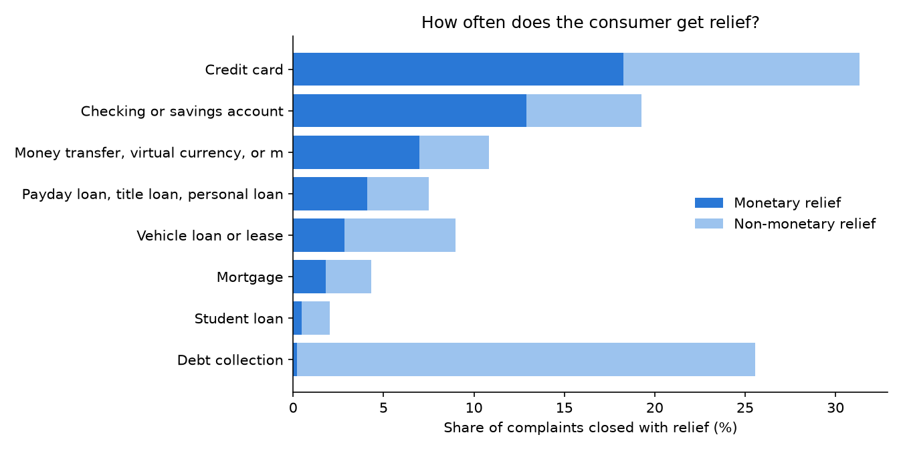
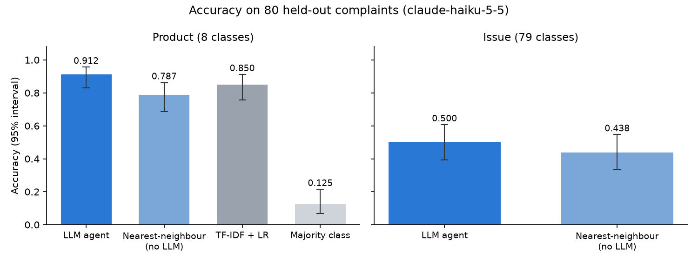

<!-- GENERATED FILE. Do not edit README.md by hand: edit report/README.template.md and run `python -m report.readme`.
     Numbers, tables and charts are filled in from data/build_summary.json, analysis/eda_summary.json,
     analysis/baseline.json and evals/runs/*.json. Last rendered 2026-11-22 19:20. -->

# Complaint triage agent

An LLM agent that does the first ten minutes of a complaint analyst's job on **real consumer-finance
complaints** from the US Consumer Financial Protection Bureau (CFPB). It reads a complaint, classifies it,
looks up similar past cases and what companies actually did about them, predicts the likely outcome, sets a
priority, routes it to a team and drafts the first reply. Every decision is scored against what really
happened to held-out complaints, and compared with classic machine-learning baselines.

**Results at a glance** (80 held-out complaints, 10 per product, model `claude-haiku-5-5`):

| Metric | LLM agent | Nearest-neighbour policy (no LLM) | TF-IDF + logistic regression | Majority class |
|---|---|---|---|---|
| Product accuracy (8 classes) | 0.912 | 0.787 | 0.850 | 0.125 |
| Issue accuracy (79 classes) | 0.500 | 0.438 | not trained | n/a |
| Outcome accuracy (3 classes) | 0.838 | 0.900 | not trained | 0.900 |
| Monetary relief F1 | 0.333 | 0.000 | 0.333 | 0.000 |
| Filed without a human | 100% | 100% | n/a | n/a |
| Filed below the risk-based priority floor | 0 | 0 | n/a | n/a |
| Cost per complaint | 3.12 LLM calls, 11,792 tokens, 7.34 s | 0.11 s | under 0.1 s | n/a |

In short: the agent is the best classifier tested on products and issues, and no method, including the agent, predicts outcomes better than "always say explanation". Details, caveats and confidence intervals are in [Results](#5-results).

---

## Contents
1. [The problem](#1-the-problem)
2. [Data: source, preparation and cleaning](#2-data-source-preparation-and-cleaning)
3. [Exploratory analysis](#3-exploratory-analysis)
4. [The agent and the baselines](#4-the-agent-and-the-baselines)
5. [Results](#5-results)
6. [Limitations](#6-limitations)
7. [Next steps](#7-next-steps)
8. [Reproduce it](#8-reproduce-it)
9. [Project structure](#9-project-structure)
10. [Deploy](#10-deploy)

---

## 1. The problem

Banks, lenders and payment companies receive complaints as free text. Before anyone can fix the problem,
an analyst has to read the complaint, file it under the right product and issue, judge how urgent it is,
send it to the right team, and reply to the consumer. In this data the median complaint is
165 words, so reading alone takes about 0.94 minutes; the research and writing take longer.

The agent automates that first pass. For each complaint it must:

1. **Classify** it by product and issue, using the regulator's own taxonomy (8 products, 79 issues).
2. **Investigate**: retrieve the most similar past complaints and their real outcomes, and historical
   relief rates for the product, issue and company.
3. **Predict the outcome**: monetary relief, non-monetary relief, or closed with an explanation only.
4. **Prioritise and route**: set low, medium or high priority, with a floor enforced in code for risk
   signals (fraud, legal threats, foreclosure or repossession, vulnerable consumers).
5. **Draft the first reply** to the consumer.

---

## 2. Data: source, preparation and cleaning

### Source

The [CFPB Consumer Complaint Database](https://www.consumerfinance.gov/data-research/consumer-complaints/)
is public. Consumers can opt in to having their written account, the *narrative*, published.

On **14 August 2026 the CFPB stopped publishing narratives** in the live database, its API and its
exports, so current exports from the website have no narrative column and cannot be used. The narratives
published before that date are kept in the CFPB's
[Consumer Complaint Database Narratives Archive](https://www.consumerfinance.gov/foia-requests/foia-electronic-reading-room/cfpb-consumer-complaint-database-narratives-archive/),
as one zip file per period. That archive is the data source for this project.

### Files and filtering funnel

The build (`python -m triage.data`) reads the zips directly, without unzipping, and filters while reading,
so 12.2 million rows fit in a laptop's memory.
4 archive file(s) ending before 2024-01-01 were not opened (1: December 2011 to April 2018; 2: May 2018 to April 2021; 3: May 2021 to October 2022; 4: November 2022 to August 2023).

| Archive file | Rows | With a narrative | Kept (in scope) |
|---|---:|---:|---:|
| 5: September 2023 to March 2024 | 945,532 | 318,804 (33.7%) | 41,869 |
| 6: April 2024 to July 2024 | 839,903 | 276,332 (32.9%) | 60,170 |
| 7: August 2024 to October 2024 | 824,514 | 229,944 (27.9%) | 45,070 |
| 8: November 2024 to December 2024 | 591,058 | 154,916 (26.2%) | 30,348 |
| 9: January 2025 to February 2025 | 811,019 | 265,405 (32.7%) | 92,762 |
| 10: March 2025 to April 2025 | 803,073 | 210,147 (26.2%) | 39,541 |
| 11: May 2025 to June 2025 | 827,343 | 219,632 (26.5%) | 42,032 |
| 12: July 2025 to August 2025 | 968,761 | 234,404 (24.2%) | 46,739 |
| 13: September 2025 to October 2025 | 1,023,636 | 157,821 (15.4%) | 41,891 |
| 14: November 2025 to December 2025 | 1,009,132 | 134,641 (13.3%) | 36,750 |
| 15: January 2026 to February 2026 | 1,038,383 | 34,351 (3.3%) | 31,556 |
| 16: March 2026 | 614,945 | 21,640 (3.5%) | 20,010 |
| 17: April 2026 | 618,293 | 21,052 (3.4%) | 19,412 |
| 18: May 2026 | 619,940 | 17,528 (2.8%) | 16,024 |
| 21: August 2026 | 667,140 | 1 (0.0%) | 0 |
| **Total** | **12,202,672** | **2,296,618** | **564,174** |

| Step | Complaints left |
|---|---:|
| All rows in the archive files read | 12,202,672 |
| Has a consumer narrative | 2,296,618 |
| In scope: narrative of 50+ characters, closed with a known outcome, one of the 8 products, received on or after 2024-01-01 | 564,174 |
| Sampled to at most 3,000 per product in each file (keeps memory bounded) | 251,510 |
| Duplicates removed, then sampled to 3,000 per product | **24,000** |

### Cleaning and design decisions

| Decision | Why |
|---|---|
| **Scope: 8 bank, lender and payments products** (Credit card; Checking or savings account; Debt collection; Mortgage; Money transfer, virtual currency, or money service; Student loan; Vehicle loan or lease; Payday loan, title loan, personal loan, or advance loan) | This is the complaint desk of a consumer-finance company. Credit-bureau complaints, most of the database, are left out: many are templated dispute letters and they belong to a different business. |
| **Start date 2024-01-01** | The CFPB renamed several products in 2023 (for example "Credit card or prepaid card" became "Credit card"). One consistent label set matters more than extra history. |
| **Narrative of at least 50 characters** | The narrative is the agent's only input. |
| **Closed outcomes only** (Closed with monetary relief, Closed with non-monetary relief, Closed with explanation) | Complaints still in progress or untimely have no outcome to score against. These map to the three classes `explanation`, `monetary_relief` and `non_monetary_relief`. |
| **3,000 complaints per product** | Equal classes, and a data set that runs on a laptop. |
| **Time-based split**: the most recent 15% held out | Train on the past, test on the future, as in production. Retrieval only ever searches the training part. Train: 20,400 complaints, 2024-01-01 to 2026-03-01. Test: 3,600 complaints, 2026-03-01 to 2026-05-31. |
| Dates parsed from ISO, US and Excel formats; text fields stripped; empty values normalised | The archive and the website use different formats. |

### Observations about the data itself

- **Share of rows with a published narrative:** 33.7% in September 2023 to March 2024 (archive file 5), against 2.8% in May 2026 (file 18).
- **No gaps:** every archive file between the first and the last one used is present.

---

## 3. Exploratory analysis

Generated by `python -m analysis.eda` (full output in [`analysis/eda_report.md`](analysis/eda_report.md)).
All figures describe the 24,000-complaint sample.

**Overview**

- **24,000 complaints**, received 2024-01-01 to 2026-05-31, **1,215 companies**, 8 products, 79 issues.
- **Outcome mix:** explanation 86.3%, non-monetary relief 7.8%, monetary relief 5.9%.
- **Narrative length:** median 165 words, 90th percentile 445 words.
- **Reading time alone:** about 0.94 minutes per complaint at 238 words per minute, or 376 analyst-hours for this sample, before any research or writing.
- **Risk signals:** fraud or identity theft 25.6%, servicemember 12.1%, legal threat 8.4%, financial hardship 7.8%, older american 7.5%.
- **Priority floor from those signals:** low 52.6%, medium 34.8%, high 12.5%.

**Relief by product**



| Product | Complaints | Median words | Monetary relief | Non-monetary relief | Timely response |
|---|---:|---:|---:|---:|---:|
| Credit card | 3,000 | 172 | 18.3% | 13.1% | 99.5% |
| Checking or savings account | 3,000 | 164 | 12.9% | 6.4% | 99.3% |
| Money transfer, virtual currency, or money service | 3,000 | 148 | 7.0% | 3.8% | 97.8% |
| Payday loan, title loan, personal loan, or advance loan | 3,000 | 160 | 4.1% | 3.4% | 97.1% |
| Vehicle loan or lease | 3,000 | 181 | 2.8% | 6.1% | 99.0% |
| Mortgage | 3,000 | 224 | 1.8% | 2.5% | 99.0% |
| Student loan | 3,000 | 170 | 0.5% | 1.6% | 88.9% |
| Debt collection | 3,000 | 113 | 0.2% | 25.4% | 99.0% |

**Most frequent issues**

| Issue | Complaints | Monetary relief | Non-monetary relief | Timely |
|---|---:|---:|---:|---:|
| Dealing with your lender or servicer | 1,898 | 0.7% | 1.4% | 86.1% |
| Managing an account | 1,625 | 11.8% | 7.6% | 99.0% |
| Trouble during payment process | 1,607 | 1.7% | 2.5% | 99.2% |
| Attempts to collect debt not owed | 1,436 | 0.2% | 27.7% | 99.5% |
| Managing the loan or lease | 900 | 4.9% | 6.3% | 98.7% |
| Other transaction problem | 877 | 5.1% | 1.7% | 99.2% |
| Problem with a purchase shown on your statement | 818 | 31.1% | 5.4% | 99.3% |
| Fraud or scam | 800 | 7.2% | 3.1% | 98.6% |
| Incorrect information on your report | 793 | 0.6% | 13.8% | 98.4% |
| Repossession | 792 | 2.0% | 5.7% | 98.6% |
| Charged fees or interest you didn't expect | 739 | 5.8% | 2.7% | 96.5% |
| Written notification about debt | 730 | 0.1% | 27.3% | 98.9% |

**Largest companies in the sample**

| Company | Complaints | Monetary relief | Non-monetary relief | Timely |
|---|---:|---:|---:|---:|
| Block, Inc. | 1,071 | 0.5% | 0.0% | 97.2% |
| MOHELA | 1,062 | 0.9% | 0.9% | 77.2% |
| JPMORGAN CHASE & CO. | 862 | 6.6% | 6.4% | 100.0% |
| WELLS FARGO & COMPANY | 801 | 11.4% | 8.0% | 100.0% |
| CAPITAL ONE FINANCIAL CORPORATION | 762 | 7.0% | 7.6% | 100.0% |
| BANK OF AMERICA, NATIONAL ASSOCIATION | 646 | 31.7% | 3.6% | 99.5% |
| Paypal Holdings, Inc | 607 | 14.2% | 17.0% | 100.0% |
| Nelnet, Inc. | 603 | 0.0% | 0.0% | 100.0% |
| CITIBANK, N.A. | 563 | 27.9% | 18.3% | 100.0% |
| Chime Financial Inc | 447 | 5.8% | 1.1% | 100.0% |

**What the analysis says**

- **Relief depends heavily on product, issue and company.** Monetary relief ranges from 0.2% (Debt collection) to 18.3% (Credit card) by product, and from 0.0% (Nelnet, Inc.) to 31.7% (BANK OF AMERICA, NATIONAL ASSOCIATION) among the largest companies. Among the most frequent issues, "Problem with a purchase shown on your statement" is the most likely route to money back (31.1%).
- **Non-monetary relief follows a different pattern:** it is highest for Debt collection (25.4%), and for the issue "Attempts to collect debt not owed" (27.7%).
- **Response times vary little, except in one corner:** Student loan has the lowest timely-response rate (88.9%); among the largest companies the lowest is MOHELA (77.2%).
- **Implication for the agent:** the narrative tells you *what* the complaint is about much better than
  *how it will end*. That is why the agent is given outcome statistics by product, issue and company as a
  tool, rather than asked to guess outcomes from text.

---

## 4. The agent and the baselines

### How the agent works

```
complaint narrative
      |
      v
 Agent loop (triage/agent.py)  <->  Claude with tool calling (claude-haiku-5-5)
      |
      |-- search_similar_complaints   TF-IDF retrieval over the training complaints, with their real outcomes
      |-- get_taxonomy                valid products and issues
      |-- get_outcome_stats           historical relief rates by product / issue / company (min. 20 cases)
      `-- submit_triage               the action
      |
      v
 triage_decisions table + logs/traces.jsonl   ->   evals/run_eval.py
```

The model chooses which tools to call and what to conclude. **Business rules live in code, not in the
prompt**, so the model cannot talk its way past them:

- `submit_triage` rejects any product or issue that is not in the taxonomy, and returns the valid values
  so the model can correct itself.
- A **priority floor** is computed from risk signals in the text and consumer tags: fraud or identity
  theft, legal threats, foreclosure, repossession or garnishment, older Americans and servicemembers.
  A submission below the floor is rejected.
- **Routing to a team** is a deterministic rule table, not a model choice.
- The loop has a step budget. If the model stops without filing, it gets one reminder, then the case is
  handed to a human.
- Complaint text is treated as data: the prompt tells the model to ignore any instructions inside it.

### Baselines

All baselines are trained on the same training complaints the agent can search.

| Baseline | What it is | Why it is here |
|---|---|---|
| **Majority class** | Always predicts the most common label | The floor any method must clear; for outcomes it is a hard bar because most complaints close with an explanation |
| **TF-IDF + logistic regression** (`triage/baseline.py`) | Product classifier, plus a class-balanced "will this end in monetary relief?" classifier | The standard cheap text model. If the agent cannot beat it, the LLM is not worth its cost for that task |
| **Nearest-neighbour policy** (`KNNPolicy` in `triage/llm.py`) | No LLM: drives the *same tools* with fixed rules (search, majority vote of the 5 nearest cases, historical base rate, submit) | Isolates what the LLM adds over the tools themselves. Also lets the whole pipeline and the tests run with no API key |

### Evaluation design

- **Held-out data only:** the evaluation samples from the most recent complaints, which retrieval never sees.
- **Same complaints for every method:** a fixed number per product, drawn with a fixed seed, so every
  column of the results table scores the same cases.
- **Scored against reality:** the CFPB's product and issue labels, and the company's actual response.
- **Safety metrics as well as accuracy:** cases filed without a human, guardrail rejections, and cases
  filed below the priority floor (must be zero).
- **Cost:** model calls, tokens and seconds per complaint.
- **Every run is kept** in `evals/runs/`, so results can be compared over time (see the run history below).

---

## 5. Results

### On the 80-complaint evaluation sample

Run `20261122T184526_claude-haiku-5-5_n80.json`, 2026-11-22; no-LLM run `20261122T192034_knn-policy-no-llm_n80.json`.



| Metric | LLM agent | Nearest-neighbour policy | TF-IDF + LR | Majority class |
|---|---|---|---|---|
| Product accuracy | 0.912 (0.83 to 0.96) | 0.787 (0.69 to 0.86) | 0.850 (0.76 to 0.91) | 0.125 |
| Issue accuracy | 0.500 (0.39 to 0.61) | 0.438 (0.33 to 0.55) | not trained | n/a |
| Outcome accuracy | 0.838 | 0.900 | not trained | 0.900 |
| Monetary relief precision / recall / F1 | 0.250 / 0.500 / 0.333 | 0.000 / 0.000 / 0.000 | 0.200 / 1.000 / 0.333 | 0 |
| Submissions rejected by a guardrail, then fixed | 3 | 45 | n/a | n/a |
| Filed below the priority floor | 0 | 0 | n/a | n/a |
| LLM calls / tokens / seconds per complaint | 3.12 / 11,792 / 7.34 | 3.56 / 0 / 0.11 | n/a | n/a |

Values in brackets are 95% Wilson intervals for a proportion out of 80.

### On the full held-out test set (3,600 complaints, baselines only)

| Metric | TF-IDF + LR | Majority class |
|---|---|---|
| Product accuracy | 0.829 | 0.056 |
| Monetary relief rate in the test set | 0.071 | |
| Monetary relief, balanced classifier | precision 0.237, recall 0.611, F1 0.342 | |

### What the results mean

**Classification.**
On product the agent scores 91.2%, against 85.0% for logistic regression and 78.7% for the nearest-neighbour policy on the same complaints; on issue 50.0% against 43.8%.
With 80 complaints the 95% intervals of the agent and logistic regression overlap, so the lead on product is not yet statistically settled; for reference, logistic regression scores 82.9% on the full test set. A larger run (`--per-product 25`) narrows the intervals.
Issue is the harder and more useful task: 79 classes, many of them close.
On issue, the intervals of the agent and the nearest-neighbour policy also overlap, so that lead needs a larger run to confirm.

**What the LLM adds beyond the tools.** The nearest-neighbour policy uses exactly the same retrieval and
statistics. The difference between it and the agent (+12.5 points on product, +6.2 on issue) is what reading and reasoning add over a vote of similar cases.

**Outcome prediction.** With 90.0% of the evaluation complaints closed with an
explanation, always guessing "explanation" scores 90.0%. The agent scores 83.8%, below that guess. On monetary relief, the agent's F1 is 0.333 against 0.333 for the balanced logistic regression.
Both are weak. The outcome depends on company practice and on facts in the company's records, not just on
what the consumer wrote (see section 3).

**Guardrails.** No complaint was filed below its risk-based priority floor by either method.
The agent needed 3 correction(s) in 80 cases; the rule-based policy needed 45 because it always starts at "low" and lets the guardrail raise it.

**Cost and speed.** About 3.12 model calls, 11,792 tokens and 7.34 seconds per complaint, against roughly 0.94 minutes for a person just to read it.

### Run history

| Date | Model | Complaints | Product | Issue | Outcome | Relief F1 | Tokens per complaint | Run file |
|---|---|---:|---:|---:|---:|---:|---:|---|
| 2026-11-22 19:20 | knn-policy (no LLM) | 80 | 0.787 | 0.438 | 0.900 | 0.000 | 0 | `20261122T192034_knn-policy-no-llm_n80.json` |
| 2026-11-22 18:45 | claude-haiku-5-5 | 80 | 0.912 | 0.500 | 0.838 | 0.333 | 11,792 | `20261122T184526_claude-haiku-5-5_n80.json` |

---

## 6. Limitations

- **Evaluation sample size.** 80 complaints gives intervals of roughly plus or minus 6 points on accuracy.
- **No issue-level baseline yet.** Issue accuracy is only compared with the nearest-neighbour policy.
- **Outcome prediction is weak for every method.** The agent should be read as a classifier and router,
  not as a predictor of how much a company will pay.
- **The draft reply is not scored automatically.** It is checked by reading examples in the demo.
- **The sample is not representative of all complaints.** Only consumers who agreed to publish their
  narrative are included, products are balanced by design, and credit-bureau complaints are excluded.
- **A fixed historical snapshot.** The CFPB no longer publishes narratives, so the data cannot be refreshed
  from the public site; it ends on 2026-05-31.
- **Retrieval is TF-IDF.** Simple and transparent, but weaker than embeddings on paraphrases.

---

## 7. Next steps

1. Run the evaluation on more complaints (`--per-product 25`) to narrow the intervals.
2. Add a TF-IDF + logistic regression **issue** classifier as a baseline.
3. Review the agent's errors and fix the most frequent cause (prompt or retrieval), measuring before and after.
4. Score draft replies with a rubric: names the specific problem, makes no promise, invents no facts.
5. Give the outcome model the company and issue as features, since section 3 shows they carry most of the signal.

---

## 8. Reproduce it

Commands are for Windows PowerShell; Mac and Linux equivalents are in comments. Each step rewrites this
README with its new numbers when it finishes.

```powershell
python -m venv .venv
.venv\Scripts\activate                     # Mac/Linux: source .venv/bin/activate
pip install -r requirements.txt
pytest -q                                  # offline tests, no data or API key needed

# Data: download the "CCDB Export" zips from the CFPB narratives archive (link in section 2). Leave them zipped.
python -m triage.data --folder C:\path\to\Downloads    # -> data/complaints.db, data/build_summary.json
python -m analysis.eda                     # -> analysis/eda_summary.json, eda_report.md, relief_by_product.png
python -m triage.baseline                  # -> analysis/baseline.json, baseline_report.md

# Agent evaluation (needs an Anthropic API key; set a spend limit on it first)
$env:ANTHROPIC_API_KEY="sk-ant-..."        # Mac/Linux: export ANTHROPIC_API_KEY=sk-ant-...
python -m evals.run_eval                   # -> evals/runs/<date>_<model>_n80.json

# Same complaints, no LLM
$env:AGENT_LLM="offline"; python -m evals.run_eval; Remove-Item Env:AGENT_LLM

# Rebuild this README by hand (for example after editing report/README.template.md)
python -m report.readme

# Demo and API
streamlit run app/ui.py
uvicorn app.api:app --reload               # POST /triage {"narrative": "..."}
```

Useful options: `python -m triage.data --since 2022-01-01` (more history),
`--per-product 5000` (bigger sample), `python -m evals.run_eval --per-product 25` (more evaluation cases).
Set `AGENT_MODEL` to try another Claude model; each run is added to the run history.

---

## 9. Project structure

```
triage/
  config.py      scope (products), outcome classes, split, model name
  data.py        reads the CFPB archive zips, filters, samples, splits, builds data/complaints.db
  tools.py       the agent's tools and the guardrails (taxonomy check, priority floor, routing)
  agent.py       system prompt and the agent loop
  llm.py         Claude backend, and the no-LLM nearest-neighbour policy
  baseline.py    TF-IDF + logistic regression baselines
analysis/
  eda.py         exploratory analysis
evals/
  run_eval.py    held-out evaluation of the agent against the baselines
  runs/          one JSON file per evaluation run (kept in git)
report/
  readme.py            renders README.md from the saved results
  README.template.md   the README's wording; edit this, not README.md
app/
  ui.py          Streamlit demo: triage a real held-out complaint and compare with what happened
  api.py         FastAPI endpoint
tests/           offline tests (fixture data in the archive's format)
```

---

## 10. Deploy

**Streamlit Community Cloud:** commit `data/complaints.db` (remove `data/*.db` from `.gitignore`), create
an app pointing at `app/ui.py`, and add `ANTHROPIC_API_KEY` under Secrets.

**Docker** (Render, Cloud Run, AWS App Runner), after building the database:

```bash
docker build -t complaint-triage .
docker run -p 8501:8501 -e ANTHROPIC_API_KEY=$ANTHROPIC_API_KEY complaint-triage
```

Set a monthly spend limit on the API key before sharing a public link.

---

**Data:** Consumer Financial Protection Bureau, Consumer Complaint Database and Narratives Archive
(US government work, public domain). Complaint narratives are the consumers' own unverified accounts,
published by the CFPB with personal information removed.